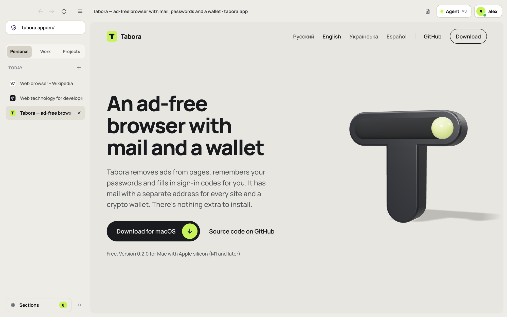

<h1 align="center">Tabora</h1>

<p align="center">
  An ad-free browser with a password vault, sign-in codes, mail and a crypto wallet built in.<br>
  Built on the Firefox engine, with its own interface.
</p>

<p align="center">
  <a href="https://tabora.app"><b>Website</b></a> ·
  <a href="https://tabora.app/#download"><b>Download for macOS</b></a> ·
  <a href="https://app.tabora.app"><b>Web mail</b></a> ·
  <a href="docs/"><b>Docs</b></a>
</p>

<p align="center">
  <a href="https://tabora.app">
    <picture>
      <source media="(prefers-color-scheme: dark)" srcset="docs/images/desktop-dark.png">
      
    </picture>
  </a>
</p>

## What is in the box

| | |
|---|---|
| **Ad and tracker blocker** | Our own filter engine, on by default, no extension to install. Filter lists (EasyList, RU AdList, EasyPrivacy, Peter Lowe's list) update on their own; every site has its own switch. |
| **Password vault** | Saved passwords are encrypted with a key derived from your account password. The vault opens only for the signed-in account and can be locked at any moment. |
| **Sign-in codes (2FA)** | One-time codes for your sites live next to the passwords and are filled into the code field for you. Import from Google Authenticator, Aegis and 2FAS. |
| **Mail** | A mailbox on `@tabora.app` inside the browser, a separate alias for every site, OpenPGP encryption with keys generated on your device, and external mailboxes over IMAP and SMTP. |
| **Crypto wallet** | Ethereum-compatible networks, Bitcoin, Solana and TRON. The recovery phrase stays on the device and is never synced. |
| **AI agent** | Works inside your tabs: plans the steps, fills in forms, and asks before it sends anything. |
| **Spaces** | Work, personal, a side project: each space has its own tabs and its own sign-ins on sites. |
| **Sync** | Tabs, bookmarks, passwords, sign-in codes and spaces are shared between your devices. Everything is encrypted on the device with a key the server never sees. A phone signs in by scanning a QR code from the computer. |
| **No telemetry** | Mozilla telemetry, studies, sponsored tiles and account prompts are switched off. |

The interface is available in English, Russian, Ukrainian and Spanish.

## Platforms

| Platform | Status | Source |
|---|---|---|
| **macOS** (Apple silicon) | Released: signed and notarized installer on [tabora.app](https://tabora.app) | this repository |
| **Android** | In development: builds in CI, not in stores yet | this repository, same engine tree ([docs/ANDROID.md](docs/ANDROID.md)) |
| **iPhone** | In development: builds for the iOS Simulator | [Tabora-App/ios](https://github.com/Tabora-App/ios) |
| **Web** | Live: mail at [app.tabora.app](https://app.tabora.app) | this repository, [`web/`](web/) |
| Windows, Linux | Not released yet | |

## Repositories

| Repository | What it holds |
|---|---|
| **browser** (you are here) | The desktop browser and the Android app (one engine, shared changes), and the web app |
| [**ios**](https://github.com/Tabora-App/ios) | Tabora for iPhone, built from Firefox for iOS (WebKit) |
| [**server**](https://github.com/Tabora-App/server) | The account server (Rust): sign-in, devices, encrypted sync storage, mail access, support; plus the infrastructure of tabora.app |
| [**site**](https://github.com/Tabora-App/site) | The [tabora.app](https://tabora.app) website |

## How it is built

Firefox sources are not stored here. `tools/build.py` downloads the pinned Firefox release
(currently 159.0.1, see [`browser.json`](browser.json)) into `engine/`, lays our changes over it
and builds with Mozilla's own build system.

Our changes live in `src/`, which mirrors the Firefox tree: an edit of an existing file is kept
next to it as `*.patch`, a new file is linked into the tree as is. Moving to a new Firefox version
is one command that re-applies the patches and reports the ones that no longer fit.

### Desktop (macOS, Linux)

```sh
python3 tools/build.py download    # Firefox sources into engine/
python3 tools/build.py import      # branding and our changes from src/
python3 tools/build.py bootstrap   # Mozilla toolchains, once
python3 tools/build.py build       # full build, 1.5 to 2 hours on a laptop
python3 tools/build.py run         # start the browser
```

After interface changes: `python3 tools/build.py build --ui`, then `run`. Edits made directly in
`engine/` become patches with `export`; `status` shows the state; `update` moves to another
Firefox version. A build for distribution needs `BROWSER_RELEASE=1`; cross-builds take
`TARGET_PLATFORM=darwin TARGET_ARCH=aarch64`. The only requirement of the tool itself is the
Python standard library.

### Android

The Android app is Mozilla's Firefox for Android from the same engine tree with our changes from
`src/mobile/`. It is built by the [Android workflow](.github/workflows/android.yml); local builds
and emulator checks are described in [docs/ANDROID.md](docs/ANDROID.md).

### Web app

```sh
cd tools/web && npm ci --ignore-scripts
node build.mjs ../../.build/web    # production build
node dev.mjs                       # development server
```

See [web/README.md](web/README.md).

## Repository layout

| Path | Contents |
|---|---|
| `browser.json` | Firefox version, brand, binary name, site addresses |
| `tools/build.py` | The build tool |
| `src/` | Our changes over the Firefox tree; `src/browser/base/content/tabora/` is the desktop interface (vault, wallet, mail, agent, sync, spaces), `src/mobile/android/` is the Android app |
| `web/` | The web app and the account module of the Android app (shared core in `web/src/core`) |
| `configs/` | Build configuration per platform, default preferences, branding |
| `i18n/` | Interface translations; the tool is in `tools/i18n` ([docs/LANGUAGES.md](docs/LANGUAGES.md)) |
| `tools/` | Android signing and local builds, web app build and tests, vendored library builds, release packaging |
| `updates/` | Update channel description ([docs/UPDATES.md](docs/UPDATES.md)) |
| `docs/` | Architecture, platforms, updates, security audits |

## Security

- Passwords, sign-in codes, bookmarks, tabs and spaces leave the device only encrypted; the key is
  derived from the account password and is never sent to the server.
- The wallet recovery phrase is not synced at all.
- Mail from the outside world is rendered in a separate content process without scripts; remote
  images load only on request.
- Updates are verified with our own signing key.

Two audits of the code are published in [docs/](docs/). If you find a vulnerability, please report
it privately through **Security → Report a vulnerability** on this repository rather than in a
public issue.

## Languages

The source language of the interface is Russian: strings are written in Russian in the code and
looked up in `i18n/<lang>.json`. This is why you will meet Russian text in the sources and in the
commit history before November 2026. Documentation and new commits are in English.

## License

[Mozilla Public License 2.0](LICENSE), the same as Firefox.

Tabora is an independent project. It is not affiliated with or endorsed by Mozilla. Firefox is a
trademark of the Mozilla Foundation.
